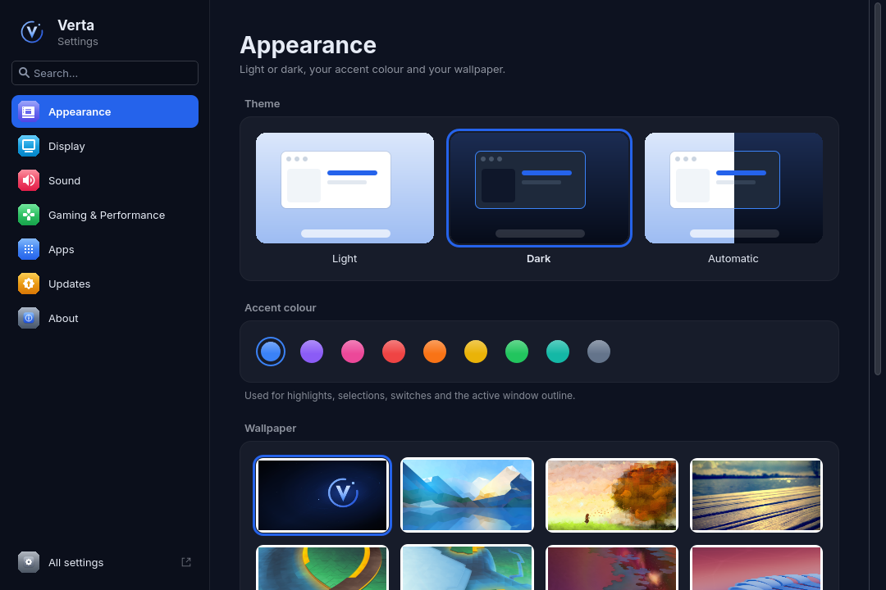
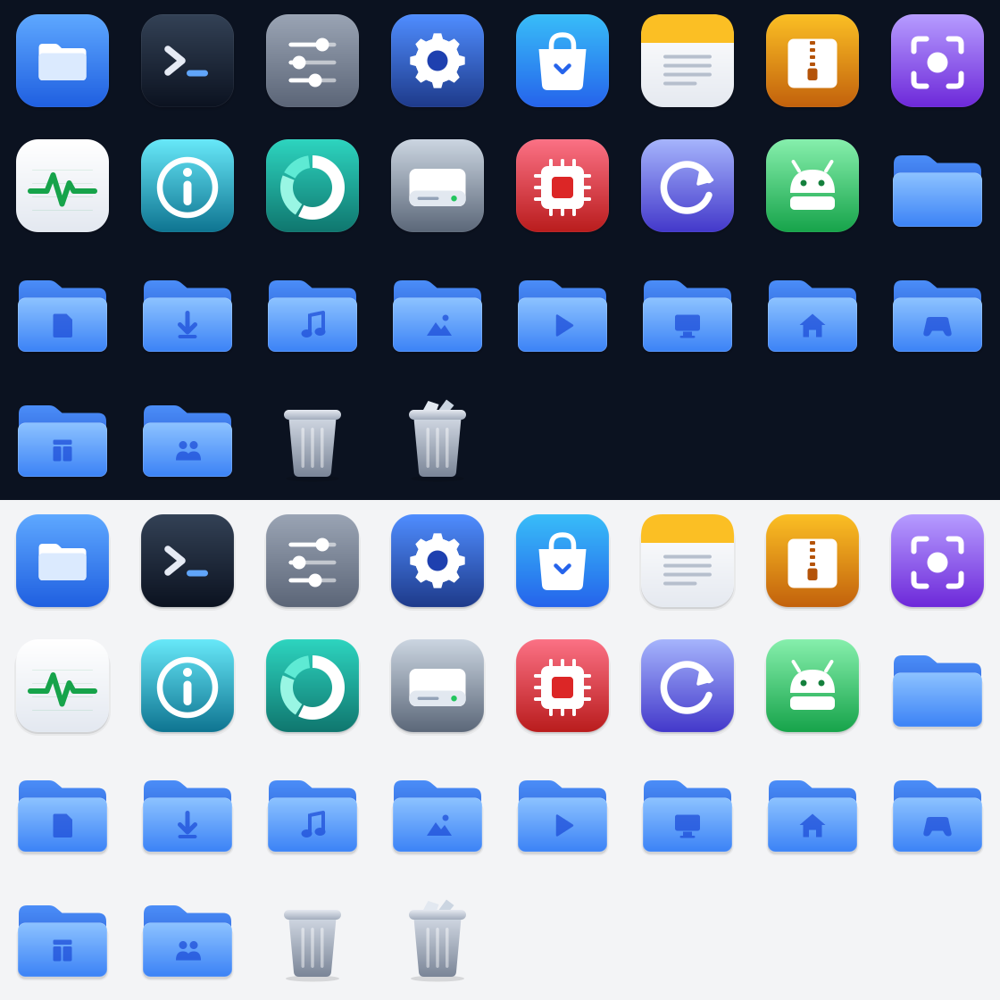

# Verta

A gaming desktop Linux OS. Verta is a custom **Fedora Atomic** image (KDE Plasma) built with
[bootc](https://containers.github.io/bootc/) on top of Universal Blue's base images, which
already include media codecs and RPM Fusion.

## What Verta adds



**Look**

| | |
|---|---|
| **Logo** | "Orbit": a V inside an open orbit ring with a moon (`art/logo.svg`; `logo-ring.svg` + `logo-v.svg` are the animated layers) |
| **Light & dark** | Two global themes, **Verta Dark** (`org.verta.desktop`, default: near-black navy, blue accents) and **Verta Light** (`org.verta.light`: soft white, Apple-like). Plasma's light/dark switch and the automatic day/night switch flip between the two, so Verta's colours stay either way |
| **Icons** | Verta icon theme: simple, flat Apple-style app tiles (one soft shadow, no gloss; every app its own shape and colour) and Mac-style blue folders, generated by `art/icons/make-icons.py`; Papirus for everything else. Duplicate launchers (KDE System Settings, Info Center, extra monitors, KDE Connect, developer tools) are hidden from the menu |
| **Window buttons** | Verta's own title bars (Aurorae themes **Verta** / **Verta Light**, `art/aurorae/make-aurorae.py`): round close, minimise and maximise/restore buttons with thin rounded glyphs that fill red, amber and green on hover, centred titles, unified with the app's header colour |
| **Menus** | **Darkly** widget style: rounder buttons and fields, frosted-glass right-click menus with roomy rows and soft shadows, smooth page and focus animations |
| **Glass** | Frosted blur behind panels, menus, popups and the terminal; rounded window corners with a thin blue outline and soft blue glow on the active window (KDE-Rounded-Corners); borderless frames |
| **Animations** | Windows glide in/out (Verta Motion), minimised windows glide into their taskbar icon and spring back out (Verta Minimise; clicking again mid-way reverses it), the Start button squishes and springs, Start menu tiles drift in one after another, popups slide a little faster, everything 25% quicker than stock Plasma; animated login splash (V pops in, ring orbits) and boot splash (ring spins around the V) |
| **Layout** | Windows 11-style floating taskbar: Start (Verta logo) and pinned apps centred, tray and clock on the right, show-desktop corner |
| **Start menu** | **Verta Start** (`org.verta.start`): search field on top (apps, files, settings, calculator; Enter opens the top hit), a grid of pinned apps, recent files, an A–Z "All apps" list that slides in, and your name, Settings, lock, sleep, restart and shut down at the bottom. Right-click any app to pin or unpin it. Opens with the Windows key |
| **Plasma style** | **Verta** (`art/plasma/make-plasma-style.py`): frosted-glass taskbar, Start menu, tray popups and tooltips with rounded corners, a hairline rim and soft shadow; rounded hover pills; a short dash under running apps and an accent-coloured dash under the active one, like Windows 11; hovering an app spotlights its windows |
| **Wallpaper** | Space scene with the Orbit mark, on desktop, lock screen and login screen |
| **Branding** | Fedora is the engine underneath, Verta is everything you see: name, version, logo and links in About This System; Verta logo wherever a distro logo is used; no Fedora global themes or wallpapers; Firefox without the Fedora start page; Flathub as the only app source; the PC's firmware boot menu says "Verta" (`verta-boot-entry.service`); Verta-branded installer. Under the hood `ID=fedora` stays so Fedora's tools keep working |



**Feels like Windows**

| | |
|---|---|
| **Taskbar** | Centred, with Start menu, pinned apps, tray and clock where Windows has them |
| **Shortcuts** | `Meta+Tab` Task View (or push the pointer into the top-left corner) · `Meta+V` clipboard history · `Meta+.` emoji · `Meta+E` Files · `Meta+I` Settings · `Meta+Shift+S` screenshot of a region · `Ctrl+Shift+Esc` System Monitor · `Alt+Tab` with window thumbnails · `Meta+D` show desktop · `Meta+L` lock |
| **Settings** | **Verta Settings** (`verta-settings`, Start → Settings): Appearance (light/dark/auto, accent colour, wallpaper, animation speed), Display, Sound, Gaming & Performance (CPU scheduler mode, power mode, MangoHud everywhere, tearing), Apps, Updates (check, install, restart, roll back) and About. *All settings* opens KDE System Settings for everything else |

**Apps from anywhere**

| | |
|---|---|
| **Windows `.exe` / `.msi`** | Bottles; double-click a Windows program and it opens in Bottles |
| **Any Linux app** | Distrobox + BoxBuddy: Ubuntu, Arch, Debian, … containers that integrate with the Start menu |
| **AppImages** | FUSE support built in; Gear Lever adds them to the Start menu |
| **Android apps** | Waydroid (Settings → Apps → Android apps → *Set up*; AMD/Intel GPUs) |
| **App Store** | Discover with the full, unfiltered Flathub |

**Games**

| | |
|---|---|
| **Steam** | RPM package plus `steam-devices` udev rules for controllers and VR |
| **gamescope** | `gamescope -- %command%` in a game's launch options for upscaling/fullscreen tricks |
| **MangoHud + GOverlay** | FPS/frametime overlay (64- and 32-bit); `mangohud %command%` |
| **GameMode** | `gamemoderun %command%` |
| **vkBasalt** | Sharpening / SMAA for Vulkan games |
| **CoreCtrl** | GPU clocks, fans and power profiles (mainly AMD) |
| **Controllers** | `xone` (Xbox wireless dongle) and `xpadneo` (Xbox controllers over Bluetooth) drivers |
| **First-boot apps** | Heroic, Lutris, ProtonUp-Qt, Bottles, BoxBuddy, Gear Lever and Flatseal from Flathub, installed in the background once the PC is online (and again whenever an update adds to the list) |

**Performance**

| | |
|---|---|
| **Gaming kernel** | Universal Blue's `ogc` kernel (the one Bazzite uses) instead of Fedora's |
| **CPU scheduler** | sched-ext `scx_lavd` via `scx_loader`, built to keep frame times steady |
| **Priorities** | `ananicy-cpp` with CachyOS' rules (games/audio up, background work down) |
| **Memory / I/O** | Tuned for zram, early writeback, per-disk I/O schedulers (NVMe none, SSD mq-deadline, HDD bfq) |
| **Audio** | PipeWire default latency halved (512 samples) |
| **Boot & shutdown** | Quiet graphical boot; no waiting for the network; ModemManager, dnf metadata refresh, the man-page index rebuild and Fedora's user-count ping off; a stuck service holds up shutdown or restart for at most 15 s instead of 90 s |
| **Desktop** | No file indexing (Baloo), no Discover/KDE Connect background daemons at login, fullscreen games may tear for lowest latency |
| **Less bloat** | Removes apps a gaming PC doesn't need (`build_files/remove.txt`) |

Because it's an atomic OS, the system part (`/usr`) is read-only and every update is a whole
new image; if an update breaks something, pick the previous entry in the boot menu (or
Settings → Updates → *Roll back*).

## Flavors

| Flavor | For |
|---|---|
| `verta` | AMD and Intel GPUs |
| `verta-nvidia` | NVIDIA GTX 16xx / RTX 20xx and newer (open kernel modules; GTX 10xx and older are not supported) |

Both are built from `ghcr.io/ublue-os/kinoite-main:45`. The kernel and its drivers come from
`ghcr.io/ublue-os/akmods:ogc-45` and, for NVIDIA, `ghcr.io/ublue-os/akmods-nvidia-open:ogc-45`,
so the NVIDIA driver always matches the kernel exactly.

## Secure Boot

Verta's kernel and drivers are signed with Universal Blue's key, not Fedora's. The installer
queues that key for enrolment, so **on the first reboot after installing** a blue
*Perform MOK management* screen appears:

1. **Enroll MOK** → **Continue** → **Yes**
2. Password: `universalblue`
3. **Reboot**

Skipped it? Run `sudo mokutil --import /etc/pki/akmods/certs/akmods-ublue.der` (same password)
from a booted system, or turn Secure Boot off in the firmware. PCs with Secure Boot off never
see this screen.

## Layout

```
Containerfile              image definition
.github/workflows/build.yml  builds both flavors and publishes them to ghcr.io (updates)
art/                       logo + wallpaper sources (SVG); icons/make-icons.py draws the icon theme
build_files/build.sh       runs inside the build; runs the numbered steps in order:
  00-kernel.sh               swap in the gaming kernel + controller drivers
  10-packages.sh             add packages.txt, remove remove.txt
  20-nvidia.sh               NVIDIA driver (verta-nvidia only)
  30-desktop.sh              make the Verta theme / splash the default
  40-tuning.sh               scheduler, priorities, boot trims
  50-branding.sh             os-release
  90-initramfs.sh            initramfs for the new kernel
system_files/              files copied onto / (themes, icons, tuning configs, services)
  usr/share/verta-settings/  Verta Settings (Python + QML/Kirigami)
disk_config/iso.toml       installer settings (+ Secure Boot key enrolment)
installer/                 installer (Anaconda) stylesheet + rendered images
scripts/                   build helpers (run inside WSL) and the Hyper-V test VM script
  brand-iso.sh               rebrands the installer ISO: Verta installer look, "Install Verta"
                             boot menu, volume label "Verta", Secure Boot key on the ISO
output/                    finished ISOs (git-ignored)
```

- Add a package: a line in `build_files/packages.txt`. Remove one: a line in `build_files/remove.txt`.
- Add a Flatpak: the `APPS` list in `system_files/usr/libexec/verta-flatpak-setup`.
- Change the taskbar: `system_files/usr/share/plasma/look-and-feel/org.verta.desktop/contents/layouts/org.kde.plasma.desktop-layout.js`.
- Change colours: `system_files/usr/share/color-schemes/VertaDark.colors` / `VertaLight.colors`.
- Change the logo, wallpaper or icons: edit `art/*.svg` or `art/icons/make-icons.py`, then run `scripts/render-art.sh`.
- Try Verta Settings without a desktop: `verta-settings --page gaming --screenshot out.png`.

## Building (Windows + WSL2 Ubuntu)

Everything runs as root in WSL, because bootc-image-builder needs rootful podman. From PowerShell
in this folder:

```powershell
# one-time: install podman + skopeo in WSL
wsl -u root -- bash scripts/setup-wsl.sh

# after editing art/*.svg
wsl -u root -- bash scripts/render-art.sh

# build the OS image
wsl -u root -- bash scripts/build-image.sh verta          # or verta-nvidia

# turn it into an installer ISO → output\verta-YYYYMMDD-HHMM.iso
wsl -u root -- bash scripts/build-iso.sh verta            # or verta-nvidia
```

Options (set before the command inside WSL, e.g. `wsl -u root -- env KERNEL_FLAVOR=main bash scripts/build-image.sh verta`):

- `KERNEL_FLAVOR=main` — use Fedora's stock kernel instead of the gaming kernel.
- `FEDORA_VERSION=46` — build on a newer Fedora once the base images publish it
  (check with `skopeo list-tags docker://ghcr.io/ublue-os/kinoite-main`).

## Testing in a Hyper-V VM (AMD/Intel flavor)

1. From an **administrator** PowerShell in this folder, create and start the VM (Gen 2, 4 CPUs,
   8 GB RAM, 64 GB disk, Secure Boot with the Microsoft UEFI CA, newest ISO attached):
   ```powershell
   powershell -ExecutionPolicy Bypass -File .\scripts\new-test-vm.ps1            # add -Replace to recreate
   ```
2. In the VM window, install (pick the disk, create your user). When it finishes, eject the ISO
   (**Media → DVD Drive → Eject**) before rebooting, or the VM boots the installer again.
3. Enrol the Secure Boot key on the blue MOK screen (see above).
4. Check:
   - the Verta boot splash, then the Verta login screen and desktop (centred taskbar)
   - Start → Settings opens Verta Settings; switching Light/Dark keeps the Verta colours
   - *About This System* says Verta and shows the `ogc` kernel
   - `systemctl status scx_loader ananicy-cpp` are running; `scxctl get` reports `lavd`
   - Steam starts and signs in (games will be slow: a VM has no real GPU)
   - a few minutes after first boot, Heroic, Lutris, Bottles, … appear in the Start menu
     (`systemctl status verta-flatpak-setup` shows progress)

A VM can't test the NVIDIA flavor; use real hardware for that.

Already have a user from an older Verta build? New users get the Verta layout automatically;
for an existing user run `plasma-apply-lookandfeel -a org.verta.desktop --resetLayout`
(this replaces that user's panels).

## Installing on a real PC

1. Write the ISO to a USB stick (8 GB+) with **Fedora Media Writer** ("Select .iso file") or
   **Rufus** in *DD image* mode. This wipes the stick.
2. Boot the PC from USB (usually F12/F8/Esc at power-on) and install.
3. Enrol the Secure Boot key on the first reboot (see above).
4. NVIDIA flavor: `nvidia-smi` should list your GPU.

## Updates

GitHub Actions (`.github/workflows/build.yml`) builds both flavors on every push to `main` and
once a day (so Fedora and driver fixes arrive even when Verta itself doesn't change), and
publishes them as:

- `ghcr.io/humandubleofficial/verta:latest`
- `ghcr.io/humandubleofficial/verta-nvidia:latest`

(plus date tags). ISOs built with `scripts/build-iso.sh` install pointing at those images, so an
installed Verta updates itself: a timer downloads new builds in the background and they are
applied at the next restart. To update by hand, use **Settings → Updates** (or Discover, or
`sudo bootc upgrade`), then restart.

Installed from an older ISO that still points at `localhost/verta`? Settings → Updates shows a
**Connect** button, or run once:

```bash
sudo bootc switch ghcr.io/humandubleofficial/verta:latest    # verta-nvidia for NVIDIA
```

The GHCR packages must be **public** for machines to download them without logging in
(GitHub → your profile → Packages → *verta* → Package settings → Change visibility).
